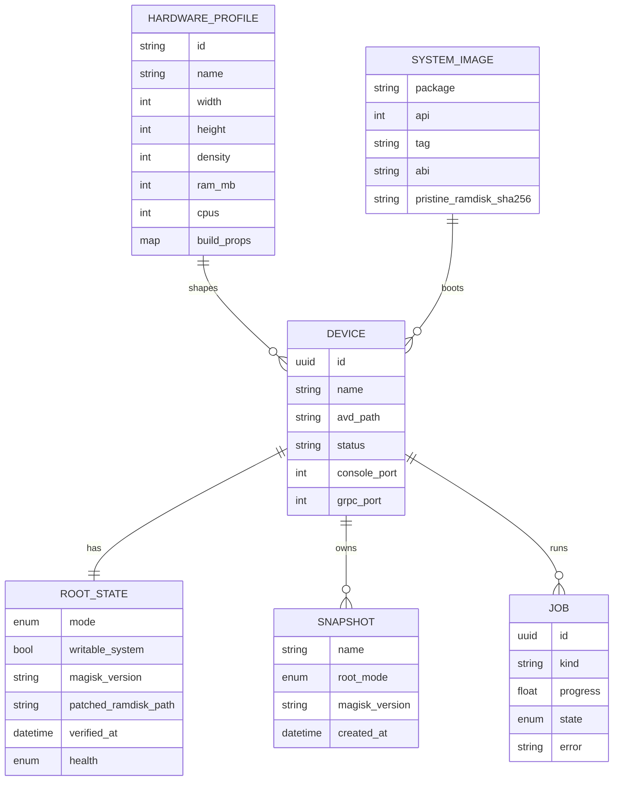

## feat: Jidr (جذر, "root") — open-source Android emulator suite with one-click root — Extensive

> Legend: **🔎 NEEDS RESEARCH** = we could not find from public sources how Genymotion does this; Abdurahman researches before the phase that needs it. **D#** = grilling decision (see "Decisions log").

## Overview

Jidr is a free, open-source (Apache-2.0 core, GPLv3 GUI; D18), pure-Rust desktop app that gives developers, security researchers, CI pipelines and AI agents a Genymotion-class Android emulator experience. It runs the open-source AOSP emulator headless under the hood. On top it adds:

- a device manager and player window,
- sensor widgets,
- a `gmtool`-style CLI and an MCP server,
- recording, snapshots and shared folders.

Its headline feature is **one-click rooted devices**: adb-root and Magisk.

The build is clean-room. Specs come only from Genymotion's public docs, the AOSP emulator's public protos and docs, and observed behaviour. No Genymotion binary is decompiled or string-dumped.

## Problem Statement

- Genymotion Desktop costs $239.99–$479.99 a year. The free tier blocks the features power users need: CLI automation (`gmtool device/config`), network profiles, camera injection, quick boot, the root toggle on Android 12+, GPS routes and biometrics.
- Android Studio's emulator is free and capable. But it is tied to Studio's UI, its controls are scattered, it has no device-farm CLI, and it offers no root path. Play Store images can't be rooted, and Magisk needs fragile third-party scripts (rootAVD) that patch the shared SDK image in place.
- No emulator is **agent-native**. Nothing exposes every action through MCP for AI coding agents.

## Proposed Solution

One daemon (`jidr daemon`) owns all device state and drives the AOSP emulator through three channels: gRPC `EmulatorController`, the telnet console and `adb`. The UI, the CLI and the MCP server are thin clients of that daemon over a versioned JSON-RPC 2.0 protocol.

Every UI action is a protocol command, so the CLI and MCP get full parity by construction. Rooting is a first-class device property (`root_mode: none | adb | magisk`) with patching per device (shared images are never touched), verification and clean revert.

## Technical Approach

### Architecture

```
 Jidr.app (Slint, GPLv3) ──┐
 jidr <cmd>  (CLI)  ───────┼── JSON-RPC 2.0, NDJSON over Unix socket (named pipe on Windows)
 jidr mcp    (rmcp stdio) ─┘                │
                                                  ▼
                                  jidr daemon  (tokio)
          ┌───────────────┬─────────────┬─────────┴──────┬───────────────┬──────────────┐
      SdkManager      DeviceRegistry   Backend trait    RootEngine      Jobs/Events     Recorder
   (sdkmanager,       (devices.json,   └ AospEmulator   (adb-root,      (progress,     (frames →
    license consent)   per-device       (spawn, gRPC,    Magisk patch,   subscriptions,  encoder)
                       locks)            console, adb)   verify)         cancel)
```

**Crates (13; Cargo dependencies enforce direction, and stream ownership is in the phase table):**

| Crate | Contents | Stream | Licence |
|---|---|---|---|
| `jidr-core` | serde model (Device, HardwareProfile, SystemImage, RootState, Snapshot, Job), error codes, protocol types, the `CommandProvider` trait | A | Apache-2.0 |
| `jidr-proto` | gRPC code generated from the SDK's `emulator_controller.proto` / `snapshot_service.proto` (vendored fallback copy) | A | Apache-2.0 |
| `jidr-adb` | wraps the `adb` binary | A | Apache-2.0 |
| `jidr-sdk` | SDK discovery and install, license consent, AVD/config.ini lifecycle, hardware profiles, download cache | A | Apache-2.0 |
| `jidr-backend` | `Backend` trait + `aosp` module (spawn, discovery file, gRPC/console clients, ports, boot wait, crash detection) | A | Apache-2.0 |
| `jidr-daemon` | command registry, JSON-RPC server, jobs, events, locks; registers providers from `jidr-widgets` and `jidr-root` | A | Apache-2.0 |
| `jidr-client` | protocol client used by the CLI, the GUI and MCP | A | Apache-2.0 |
| `jidr-mcp` | rmcp server | A | Apache-2.0 |
| `jidr-widgets` | `CommandProvider` for sensors, phone, network, dev tools, screenshots, recording, snapshots | B | Apache-2.0 |
| `jidr-cpio` | ramdisk cpio + gz/lz4/xz (standalone) | C | Apache-2.0 |
| `jidr-root` | `CommandProvider` for root modes (adb, Magisk, verify, revert) | C | Apache-2.0 |
| `jidr-ui` | Slint GUI (stream C owns only `src/root/**`) | B | **GPLv3** |
| `apps/jidr` | CLI + `daemon` + `mcp` subcommands (hand-written clap) | A | Apache-2.0 |
| `apps/jidr-gui` | GUI binary | B | **GPLv3** |
| `xtask` | `ci`, `license-check`, `e2e-mac` (A); `release` (C) | A/C | Apache-2.0 |
| `site/` | Astro landing page (not in the Cargo workspace) | C | Apache-2.0 |

Rules: Phase 0 creates every crate stub and the root `Cargo.toml`, so streams B and C never edit the root `Cargo.toml`, `apps/jidr` or another stream's files. UI-only view state (window size, zoom, panel layout) stays local to the GUI and is not a protocol command.

**Protocol (improves on PhotoCraft's, which had no events or error codes):**

- JSON-RPC 2.0 framing over newline-delimited JSON (matches MCP). Unix socket at `~/Library/Application Support/Jidr/daemon.sock`, mode 0600.
- `hello {version}`: the CLI, GUI and MCP ship with the daemon, so a mismatch only means a stale daemon. The client gets `E_DAEMON_STALE`, and the CLI offers to restart the daemon. No semver negotiation.
- Method namespaces: `sdk.*`, `image.*`, `profile.*`, `device.*` (create, edit, clone, start, stop, reset, delete, list, details, connect_info), `root.*` (set, verify, status), `sensor.*`, `phone.*`, `network.*`, `clipboard.*`, `file.*` (install, push, pull, flash), `logcat.*`, `snapshot.*`, `media.*` (screenshot, record), `jobs.*`, `events.subscribe`, `commands.list`.
- Each provider (daemon core, `jidr-widgets`, `jidr-root`) registers rows `{id, label, params: JSON Schema (schemars), destructive, longRunning}` through `CommandProvider`. `commands.list` feeds MCP's generic `command_list`/`command_run`; the CLI is hand-written clap over `jidr-client`.
- Long operations (image download, boot, Magisk patch) are jobs: `{job, pending}` plus progress events, with cancel.
- Per-device single-writer lock. A conflicting call gets `E_DEVICE_BUSY {holder, op}`.
- Eight error codes, which are also the CLI exit codes: `0 ok · 2 usage · 3 not_found · 4 busy · 5 boot_timeout · 6 sdk · 7 root_failed · 8 daemon_stale` (1 = unexpected).

**Display pipeline:**

- The player talks to the emulator **directly**, not through the daemon. `device.connect_info` returns the gRPC endpoint and token, and the GUI streams `streamScreenshot(RGBA8888, downscaled to window size)` into the Slint image. Input goes back via `streamInputEvent` and `sendKey`. The daemon still owns lifecycle; MCP screenshots go through the daemon (`media.screenshot`).
- Budget: ≥30 fps at 1080×2400 downscaled to the window, input-to-photon ≤ 80 ms on M-series. Try inline frames + `SharedPixelBuffer` first. Move to MMAP transport and/or Slint wgpu texture import only if the budget is missed (D20). egui is the documented fallback.

**Root engine (headline):**

| Mode | Images | Mechanism | Revert | Verify |
|---|---|---|---|---|
| `none` | all | stock launch | — | `adb shell id` → uid 2000 |
| `adb` | default, google_apis, atd | `adb root` after boot; optional `writable_system` adds `-writable-system` + `adb remount` | `adb unroot`; drop overlay | `adb shell id` → uid=0 |
| `magisk` | all (Play Store: full support targeted via R&D spike, guided-tap beta as fallback; D6/D21) | 1. Hash the pristine `ramdisk.img`. 2. Download the pinned Magisk APK from official GitHub releases and check its SHA-256. 3. Patch the cpio on the host in Rust: `magiskinit` + `overlay.d` + `.backup/.magisk`. 4. Write `<avd>/jidr/ramdisk.magisk-<ver>.img`. 5. Cold boot with `-ramdisk <patched> -no-snapshot-load` (API 28: `-feature -SystemAsRoot`). 6. Install the app and finish env setup (+1 reboot). 7. Grant shell su automatically (apps get Magisk's normal prompt; opt-in "auto-grant all" per device, off by default; D22). | stop passing `-ramdisk`; delete the patched file; cold boot | `adb shell su -c id` → uid=0 and `su -c 'magisk -v'` |

- Never modify the shared SDK `ramdisk.img`. Never bundle Magisk (GPL-3.0); download it at runtime and show the license and source link.
- Clean-room: Magisk's and rootAVD's scripts are GPL, so we may read them for the documented ramdisk layout but never copy them. avdroot (MIT) is prior art we may port with attribution.
- Each snapshot is tagged with `{root_mode, magisk_version}`. Loading one under a different mode is refused.
- Re-patch when the pristine hash changes (image update) or Magisk is upgraded. Patches never stack.
- UI copy states plainly: "Play Integrity cannot pass on any emulator; Zygisk/DenyList only hides root from local checks."

**SDK and licensing:**

- Never bundle the emulator, system images or Magisk. `jidr-sdk` installs them on the user's machine via `sdkmanager` after showing the actual license text and recording consent per license hash (headless: `jidr sdk install --accept-licenses` prints each license hash and records consent; re-prompt when the text changes; D8).
- SDK ownership (D3): a private SDK under `~/Library/Application Support/Jidr/sdk`; Android Studio's SDK and AVDs are only ever read (optional read-only import), never written.
- Supported Android versions (D23): API 29–36 arm64 supported and CI-tested; API 28 best-effort; API 25–27 not offered.
- Device catalog (D24): built-in profiles use generic names ("Phone 6.1″ FHD+", "Tablet 11″", "Small phone 5″"); the SDK's own device definitions are imported as-is.
- The image picker shows only images whose ABI matches the host (arm64-v8a on Apple Silicon).



### Feature parity map (Genymotion public docs → Jidr mechanism)

| Genymotion feature | Jidr mechanism | Confidence |
|---|---|---|
| Battery widget / `battery set*` | gRPC `setBattery`; console `power ac/health` | ✅ |
| GPS widget + lat/long/alt/accuracy/bearing | gRPC `setGps` | ✅ |
| GPS routes GPX/KML (PRO) | daemon job that interpolates track points and calls `setGps` at a set rate | ✅ |
| Rotation `setangle` | gRPC `setPhysicalModel` / console `rotate` | ✅ (docs conflict on rotate semantics; test it) |
| Motion sensors 3D (PRO) | gRPC `setSensor` / `setPhysicalModel` | ✅ |
| Phone call / SMS | gRPC `sendPhone`, `sendSms`; console `gsm` | ✅ |
| Baseband: gsm signal/data/voice | console `gsm signal/data/voice` | ✅ |
| Baseband: operator & SIM MCC/MNC, operator name, MSIN (PRO) | **🔎 NEEDS RESEARCH**: how Genymotion sets operator/SIM identity; does the AOSP emulator modem simulator expose it? | ⚠️ |
| Network: wifi/mobile on/off, speed/delay profiles | console `network speed/delay`; `svc wifi/data` via adb | ✅ |
| Network: packet-loss / bad-DNS profiles (`4g-high-losses`, `4g-bad-dns`) | **🔎 NEEDS RESEARCH**: how Genymotion injects loss and DNS failure; the AOSP console has only speed/delay | ⚠️ |
| Signal strength per wifi/mobile | console `gsm signal`; wifi signal **🔎 NEEDS RESEARCH** | ⚠️ |
| Identifiers: Android ID, IMEI/MEID | Android ID via `settings put secure android_id` (needs root); IMEI **🔎 NEEDS RESEARCH**: how Genymotion changes IMEI live | ⚠️ |
| Build props (MODEL, BRAND, FINGERPRINT…) | **🔎 NEEDS RESEARCH**: Genymotion sets these at creation; for us: `-prop` only covers `qemu.*`; `resetprop` needs Magisk; or a ramdisk/vendor overlay? | ⚠️ |
| Disk I/O read-rate limit (High/Mid/Low) | **🔎 NEEDS RESEARCH**: Genymotion's mechanism; QEMU has block throttling but the AOSP emulator doesn't expose it | ⚠️ |
| Camera / media injection: webcam, image, video files (PRO) | webcam via `-camera-back webcamN`; image/video file → camera **🔎 NEEDS RESEARCH** (virtualscene posters? a v4l2loopback-equivalent on macOS?) | ⚠️ |
| Microphone / audio injection | gRPC `injectAudio` | ✅ |
| Biometrics scenarios (PRO) | gRPC `sendFingerprint` (touched/removed). Dirty/partial/too-fast scenarios **🔎 NEEDS RESEARCH** | ⚠️ |
| Android controls (D-pad, volume, media keys) | gRPC `sendKey` | ✅ |
| Dev tools: root toggle, show taps, pointer location, layout bounds, animations | root engine; `settings put system show_touches/pointer_location`; `setprop debug.layout`; `settings put global *_animation_scale` | ✅ |
| Gamepad passthrough (PRO) | **🔎 NEEDS RESEARCH**: Genymotion's mechanism; maybe `sendKey` gamepad keycodes plus `gilrs` on the host | ⚠️ (post-MVP) |
| Device Link (real phone mirrors sensors) | post-MVP; **🔎 NEEDS RESEARCH** | ⚠️ |
| Superuser allow/deny prompt (Android 12+) | Magisk's own su prompt. **🔎 NEEDS RESEARCH**: which su app Genymotion ships (only matters for adb-mode parity) | ⚠️ |
| Clipboard sharing toggle | gRPC `get/set/streamClipboard` | ✅ |
| Drag-drop APK / zip flash / other files | `adb install -r` (signature-mismatch prompt) / flash = **🔎 NEEDS RESEARCH**: Genymotion's flash semantics (we'd use `adb root && remount && push` for `/system` zips) / `adb push /sdcard/Download` | ⚠️ (flash) |
| Screenshot / screencast | `getScreenshot` → PNG; recording = encode the frame stream (no 180 s cap) or console `screenrecord` webm as fallback | ✅ |
| Quick boot / cold boot (PRO) | emulator snapshots (`default_boot`) / `-no-snapshot-load` | ✅ |
| Snapshot manager (Genymotion lacks this) | `SnapshotService` list/save/load/delete, tagged with root mode | ✅ (differentiator) |
| Shared folders (Genymotion lacks this) | post-MVP adb sync watcher (D12) | ⏭️ |
| Multitouch with mouse modifiers | our own gestures over `sendTouch` multi-pointer. Genymotion's exact bindings are not public (🔎 optional) | ✅ |
| Pixel-perfect 1:1, fullscreen, skins, resize | UI | ✅ |
| Default in-device shortcuts | not public: define our own (🔎 optional) | — |
| gmtool exit codes 1–14 | our own typed codes + versioned `--json`; no gmtool-compat layer in the MVP (D10) | ✅ |
| Genymotion Shell (port 6379 REPL) | `jidr shell` REPL over the same protocol (post-MVP) | ✅ |

## Implementation Phases

Three work streams, one `/goal` session each. Each stream has its own git worktree, its own `CARGO_TARGET_DIR=target/agent-<stream>`, and owns a disjoint set of crates (D27):

| Stream | Phases | Starts | Blocked by |
|---|---|---|---|
| **A: Core platform** | 0, 1, 2, 3a–c, 4a–c, 5a–b, 6 | day 1 | — |
| **B: Player & widgets** | 7a–c, 8a–b, 10a–b | after tag `protocol-v0.1` (end of 4c) **and** ADR-0001 (Phase 1) | design system `docs/design/tokens.json` for 7a styling (Slint default style until then) |
| **C: Root, ship & site** | 9a (day 1), 11a (day 1), 9b (day 1), 9c–e, 11b, 12a–b | 9a, 9b and 11a on day 1; 9c+ after `protocol-v0.1` | brand kit + domains (human) for 11a/11b; Apple Developer ID secrets (human) for 12b |

Coordination: a stream that needs something from another stream's crate files an entry in `docs/gaps.md` (`Needs | From stream | Blocking phase`) and keeps working on something else. The owner picks it up next. Emulator integration tests run on Linux KVM CI with **x86_64** images on every PR. The **arm64** Apple Silicon run (`cargo xtask e2e-mac`) on Abdurahman's Mac is the release gate (D28). Each phase's acceptance criteria say which applies.

The parity map's ⚠️ rows (🔎 research) are **out of MVP scope**. No agent works on them until Abdurahman's research lands in `docs/gaps.md` (D11).

### Phase 0 (A): Workspace bootstrap
- **Status:** Done
- **Scope:** Cargo workspace with every crate stubbed, `rust-toolchain.toml`, never-crash clippy policy (`deny(unwrap_used, expect_used, panic)` outside tests), CI (fmt, clippy, tests on macOS + Linux; a Linux KVM job for `--features emulator`), `xtask ci` and `xtask license-check` (fails if `slint` is in the dependency tree of `apps/jidr`), split licensing (D18), `AGENTS.md`/`CLAUDE.md` (rules, finish checklist, stream ownership), `docs/clean-room.md` (allowed sources and log), `docs/gaps.md`, `docs/parity.md` (hand-edited table: Feature | Genymotion tier | Jidr status | Evidence), `docs/decisions/`. All other docs are created by the phase that needs them.
- **Files touched:** `Cargo.toml`, `crates/*/Cargo.toml` + `src/lib.rs` stubs, `apps/*/`, `xtask/src/{main,license_check}.rs`, `.github/workflows/ci.yml`, `AGENTS.md`, `CLAUDE.md`, `LICENSE-APACHE`, `crates/jidr-ui/LICENSE-GPL`, `apps/jidr-gui/LICENSE-GPL`, `NOTICE`, `docs/{clean-room,gaps,parity}.md`
- **Acceptance criteria:** `cargo xtask ci` is green; `cargo xtask license-check` fails when `slint` is temporarily added to `apps/jidr` (shown by a test).
- **Validation:** `cargo xtask ci`

### Phase 1 (A): Display + input spike (go/no-go)
- **Status:** Not started
- **Scope:** Throwaway `spikes/display`: boot an existing arm64 AVD headless with `-grpc`, read the discovery file, stream inline RGBA into a Slint window via `SharedPixelBuffer`, send touches back, print fps / CPU / input latency. If the budget is missed, try MMAP, then the wgpu import. Record the numbers in `docs/decisions/0001-frame-transport.md`.
- **Files touched:** `spikes/display/**`, `docs/decisions/0001-frame-transport.md`
- **Acceptance criteria:** **pass** = ≥30 fps at 1080×2400 downscaled to a 400 px-wide window and median input latency ≤80 ms on the dev Mac; otherwise the ADR records the fallback decision (MMAP / wgpu / egui).
- **Validation:** `manual 1. cargo run -p spike-display -- --avd <name> 2. tap Settings and confirm it opens 3. confirm the printed fps ≥ 30 and latency ≤ 80 ms match ADR-0001`

### Phase 2 (A): Core model + SDK + AVD
- **Status:** Not started
- **Scope:** `jidr-core` model and error codes; `jidr-sdk`: SDK detection (private SDK, D3; Studio SDK read-only), license text and consent store per hash (D8), sdkmanager wrapper with progress, ABI filter (arm64 on Apple Silicon), API 29–36 catalog (D23), disk-space precheck, HVF check, AVD create/edit (config.ini)/clone/delete/factory reset, built-in generic profiles (D24).
- **Files touched:** `crates/jidr-core/**`, `crates/jidr-sdk/**`, `assets/profiles/*.toml`, `scripts/e2e-studio-untouched.sh`
- **Acceptance criteria:** unit tests for config.ini round-trip, consent store and ABI filter; integration test creates/clones/deletes an AVD; Studio SDK checksum is unchanged.
- **Validation:** `cargo nextest run -p jidr-core -p jidr-sdk && cargo nextest run -p jidr-sdk --features emulator && scripts/e2e-studio-untouched.sh`

### Phase 3a (A): gRPC bindings + adb
- **Status:** Not started
- **Scope:** `jidr-proto` build.rs (generate from the installed SDK proto, with a vendored fallback copy); `jidr-adb` wrapper (devices, shell, install, push/pull, logcat, root/unroot, connect).
- **Files touched:** `crates/jidr-proto/**`, `crates/jidr-adb/**`
- **Acceptance criteria:** proto builds with and without an SDK present; adb wrapper unit tests with a fake `adb` binary.
- **Validation:** `cargo nextest run -p jidr-proto -p jidr-adb`

### Phase 3b (A): Backend launch
- **Status:** Not started
- **Scope:** `Backend` trait + `aosp` module: dynamic port allocation (console/adb pairs + gRPC; `adb connect` past 5585, D9), spawn with `-no-window -grpc -grpc-use-token -no-boot-anim`, `LaunchOptions { extra_args, ramdisk, cold_boot, wipe }` (the hook stream C needs for Magisk), discovery-file parsing, token auth, boot wait (`sys.boot_completed`), quick-boot snapshot on stop by default (D29).
- **Files touched:** `crates/jidr-backend/**`
- **Acceptance criteria:** integration test boots API 35, reads the battery over gRPC, stops, and cold boots with a custom `-ramdisk` path passed through `LaunchOptions`.
- **Validation:** `cargo nextest run -p jidr-backend --features emulator`

### Phase 3c (A): Backend resilience
- **Status:** Not started
- **Scope:** crash detection (process exit, gRPC drop) with logs auto-saved and no auto-restart (D9); re-adopting running emulators after a daemon restart; refusing an AVD already running elsewhere (Android Studio lock); telnet console client (network speed/delay, gsm, power).
- **Files touched:** `crates/jidr-backend/src/{crash,adopt,console}.rs`
- **Acceptance criteria:** fault-injection test (kill the emulator process) reports `Crashed` with a log path; re-adopt test; double-launch refused.
- **Validation:** `cargo nextest run -p jidr-backend --features emulator`

### Phase 4a (A): Daemon core
- **Status:** Not started
- **Scope:** `CommandProvider` trait in `jidr-core`; `jidr-daemon` registry, JSON-RPC 2.0 NDJSON server on the Unix socket, `hello` stale check, the eight error codes, per-device locks; core `device.*`, `sdk.*`, `image.*`, `profile.*`, `file.*`, `logcat.*`, `device.connect_info` commands.
- **Files touched:** `crates/jidr-core/src/provider.rs`, `crates/jidr-daemon/**`
- **Acceptance criteria:** conformance tests: bad JSON → -32700, unknown param → -32602 naming the key, busy lock, stale daemon.
- **Validation:** `cargo nextest run -p jidr-daemon`

### Phase 4b (A): Jobs, events, lifecycle, client
- **Status:** Not started
- **Scope:** jobs with progress and cancel; `events.subscribe` (device state, boot progress, job progress, logcat); auto-start on first client and idle exit 10 min after the last device stops (D4); `jidr-client` library.
- **Files touched:** `crates/jidr-daemon/src/{jobs,events,lifecycle}.rs`, `crates/jidr-client/**`
- **Acceptance criteria:** job cancel leaves the state unchanged; subscriber receives boot progress; the daemon exits after idle (time-mocked test).
- **Validation:** `cargo nextest run -p jidr-daemon -p jidr-client`

### Phase 4c (A): Protocol v0.1 freeze
- **Status:** Not started
- **Scope:** `docs/control-protocol.md` (written from `commands.list` output); fuzz test of the JSON-RPC parser and params validation (not every command); git tag `protocol-v0.1`, which unblocks streams B and C.
- **Files touched:** `docs/control-protocol.md`, `crates/jidr-daemon/tests/fuzz_params.rs`
- **Acceptance criteria:** fuzz test runs 10k cases with no panic; tag exists.
- **Validation:** `cargo nextest run -p jidr-daemon && git rev-parse protocol-v0.1`

### Phase 5a (A): CLI
- **Status:** Not started
- **Scope:** hand-written clap CLI over `jidr-client`: `device create/start/stop/list/details/clone/reset/delete`, `install/push/pull/flash/logcat`, `image list/install`, `profile list`, `sdk install --accept-licenses`, `root set/verify/status` and `snapshot *` (thin calls; the handlers come from streams B/C), `--json` everywhere (versioned), `--wait-boot --timeout`, `--name/--all`, exit codes = error codes, clap completions.
- **Files touched:** `apps/jidr/src/**`, `docs/cli.md`, `scripts/e2e-cli.sh`
- **Acceptance criteria:** `assert_cmd` tests against a fake daemon; `scripts/e2e-cli.sh` does create → start → wait-boot → install → stop → delete non-interactively.
- **Validation:** `cargo nextest run -p jidr && scripts/e2e-cli.sh`

### Phase 5b (A): Cache, uninstall, logs
- **Status:** Not started
- **Scope:** Magisk APK cache by SHA-256 + `--magisk <path>` plumbing (the cache API is used by stream C), `jidr cache prune`, per-device disk usage in `device.details` (D30); `jidr uninstall [--purge]` that never touches the Studio SDK and removes Jidr MCP entries (D31); `jidr device logs --zip`.
- **Files touched:** `apps/jidr/src/{cache,uninstall,logs}.rs`, `crates/jidr-sdk/src/cache.rs`
- **Acceptance criteria:** after `uninstall --purge`, no Jidr-owned files or processes remain and the Studio SDK checksum is unchanged.
- **Validation:** `cargo nextest run -p jidr && scripts/e2e-studio-untouched.sh`

### Phase 6 (A): MCP server
- **Status:** Not started
- **Scope:** `jidr mcp` over stdio (rmcp): generic `command_list` / `command_run` / `jobs_list` / `jobs_cancel`, plus typed `screenshot` (PNG ≤1024 px), `tap`, `swipe`, `type_text`, `ui_dump`, `logcat_tail`; annotation hints on every tool; destructive policy (D5); "Add Jidr to Claude" config snippet in `docs/mcp.md`; 5 scripted agent tasks; latency recorded (not gated).
- **Files touched:** `crates/jidr-mcp/**`, `docs/mcp.md`
- **Acceptance criteria:** the 5 agent tasks pass over MCP; destructive tools are refused without `--allow-destructive` on a non-`agent-owned` device.
- **Validation:** `cargo nextest run -p jidr-mcp --features emulator`

### Phase 7a (B): UI shell
- **Status:** Not started
- **Scope:** Slint app shell, theme tokens from `docs/design/tokens.json` (Slint default style until it exists), light/dark, `@tr` for every string, RTL mirroring check (D33), offscreen snapshot harness with golden PNGs per theme, daemon connection + reconnect.
- **Files touched:** `crates/jidr-ui/**`, `apps/jidr-gui/**`
- **Acceptance criteria:** the snapshot harness renders the shell in light, dark and RTL and matches the goldens.
- **Validation:** `cargo nextest run -p jidr-ui && cargo run -p jidr-ui --example snapshot -- --check`

### Phase 7b (B): Launcher, first run, create/edit
- **Status:** Not started
- **Scope:** first-run wizard (SDK detection, license text with explicit accept, image download progress), device list with live status/root badge/disk usage, create/edit dialog (profile, Android version, root mode defaulting to `adb` where allowed with Magisk highlighted (D7), RAM/CPU, resolution/density), command palette (⌘K).
- **Files touched:** `crates/jidr-ui/src/{launcher,wizard,device_form,palette}/**`
- **Acceptance criteria:** golden snapshots for each screen and state (empty, populated, downloading, error); manual first-run walkthrough.
- **Validation:** `cargo run -p jidr-ui --example snapshot -- --check`

### Phase 7c (B): Player window
- **Status:** Not started
- **Scope:** direct gRPC frame stream from `device.connect_info` (ADR-0001 transport), input (mouse, keyboard, multitouch via modifiers), right toolbar (volume, rotate, pixel-perfect, back/home/recents, power, screenshot, record), drag-drop (apk → install with signature-mismatch prompt; zip → flash; other → `/sdcard/Download`), shared clipboard toggle, widget panel host.
- **Files touched:** `crates/jidr-ui/src/player/**`
- **Acceptance criteria:** player hits the ADR-0001 budget on the dev Mac; drag-drop installs an APK; golden snapshots of the chrome.
- **Validation:** `manual 1. start "Pixel-ish 6.1" 2. scroll Settings 30 s with the debug overlay on (≥30 fps) 3. drag an APK onto the screen and confirm it launches`

### Phase 8a (B): Core widgets
- **Status:** Not started
- **Scope:** `jidr-widgets` `CommandProvider` + panels: battery, rotation + motion sensors, network (Wi-Fi/mobile toggles, speed/delay profiles), phone/SMS + gsm baseband, Android controls, dev tools (show taps, pointer location, layout bounds, animation scales), clipboard. Identifiers, audio injection and biometrics are post-MVP.
- **Files touched:** `crates/jidr-widgets/**`, `crates/jidr-ui/src/widgets/**`
- **Acceptance criteria:** every widget command has an adb-observable assertion (`dumpsys battery`, `settings get`, etc.) in an emulator test.
- **Validation:** `cargo nextest run -p jidr-widgets --features emulator`

### Phase 8b (B): GPS
- **Status:** Not started
- **Scope:** GPS widget with an OpenStreetMap tile map (attribution, configurable URL, D14), coordinate fields, GPX/KML route replay job with speed control.
- **Files touched:** `crates/jidr-widgets/src/gps/**`, `crates/jidr-ui/src/widgets/gps/**`
- **Acceptance criteria:** setting Tripoli coordinates shows in `dumpsys location`; replay of a 3-point GPX moves the reported location in order.
- **Validation:** `cargo nextest run -p jidr-widgets --features emulator -- gps`

### Phase 10a (B): Screenshots + recording
- **Status:** Not started
- **Scope:** `media.screenshot` (PNG to folder + clipboard); `media.record` encodes the frame stream to MP4/H.264 with VideoToolbox (D13; audio post-MVP).
- **Files touched:** `crates/jidr-widgets/src/media/**`, `crates/jidr-ui/src/recording.rs`
- **Acceptance criteria:** a 5-minute recording passes `ffprobe` (codec h264, duration ≈300 s ±2 s, frame count ≥ 30×300×0.9).
- **Validation:** `cargo nextest run -p jidr-widgets --features emulator -- media`

### Phase 10b (B): Snapshot manager
- **Status:** Not started
- **Scope:** `snapshot.*` provider (list/save/load/delete with root-mode tags; refuse loading under a different root mode, D29) and the snapshot UI with thumbnails.
- **Files touched:** `crates/jidr-widgets/src/snapshots.rs`, `crates/jidr-ui/src/snapshots/**`
- **Acceptance criteria:** save → modify → load round-trip restores the state; a cross-root-mode load is refused.
- **Validation:** `cargo nextest run -p jidr-widgets --features emulator -- snapshot`

### Phase 9a (C): Play Store root R&D spike ★ (day 1, no product code)
- **Status:** Not started
- **Scope:** time-boxed ≈3 agent-days in `spikes/playstore-root/` using adb and the emulator directly (no daemon needed). Try, in order (D21): (1) a ramdisk `overlay.d` boot script that writes the shell uid's grant into Magisk's policy DB; (2) uiautomator auto-tap of the Grant prompt; (3) guided tap. Write `docs/decisions/0002-play-store-root.md`.
- **Files touched:** `spikes/playstore-root/**`, `docs/decisions/0002-play-store-root.md`
- **Acceptance criteria:** **full-support pass** = `su -c id` → uid=0 with zero human input on API 33/34/35 `google_apis_playstore` arm64; **beta pass** = the ADR documents why (1) and (2) failed and specifies the guided-tap flow.
- **Validation:** `manual 1. run spikes/playstore-root/run.sh --api 35 2. confirm uid=0 printed without touching the device 3. read ADR-0002`

### Phase 9b (C): Ramdisk cpio library (day 1)
- **Status:** Not started
- **Scope:** standalone `jidr-cpio`: read/write cpio newc, gz/lz4-legacy/xz compression detection and round-trip, add/replace/remove entries. Clean-room from the cpio format spec; no GPL code copied.
- **Files touched:** `crates/jidr-cpio/**`
- **Acceptance criteria:** round-trip of a real emulator `ramdisk.img` is byte-identical after decompress → parse → write → compress with the same settings; property tests.
- **Validation:** `cargo nextest run -p jidr-cpio`

### Phase 9c (C): adb root mode
- **Status:** Not started
- **Scope:** `jidr-root` `CommandProvider`: `root.set {mode: none|adb}`, `root.verify`, `root.status`; adb mode via `adb root` after boot (optional `writable_system` is post-MVP); revert; root-mode tags written into snapshots via `snapshot.*` metadata (request through gaps if 10b isn't ready).
- **Files touched:** `crates/jidr-root/src/{lib,adb_mode,verify}.rs`
- **Acceptance criteria:** `none → adb → none` on API 30/33/35 `google_apis`, verified each step.
- **Validation:** `cargo nextest run -p jidr-root --features emulator -- adb`

### Phase 9d (C): Magisk mode ★ headline
- **Status:** Not started
- **Scope:** pinned Magisk release (`assets/magisk-pins.toml`: version, URL, SHA-256), download through the 5b cache, host-side patch with `jidr-cpio` into `<avd>/jidr/ramdisk.magisk-<ver>.img`, launch via `LaunchOptions.ramdisk` + cold boot, app install + env setup + reboot, shell su auto-grant (D22; Play Store path per ADR-0002), verify, revert, re-patch when the pristine hash or the pin changes, Play Integrity notice, `docs/root.md`.
- **Files touched:** `crates/jidr-root/src/magisk/**`, `assets/magisk-pins.toml`, `docs/root.md`, `scripts/e2e-root.sh`
- **Acceptance criteria:** `scripts/e2e-root.sh` cycles none → adb → magisk → none on API 30/33/35 `google_apis` and checks `su -c id` = uid=0 in magisk mode; the SDK `ramdisk.img` hash is unchanged at the end. Linux KVM (x86_64) on PRs; arm64 in `xtask e2e-mac` before release.
- **Validation:** `scripts/e2e-root.sh`

### Phase 9e (C): Root UX
- **Status:** Not started
- **Scope:** root-mode cards in the create/edit dialog and a root section in the dev-tools widget, the "Rooted ✓ / unverified / failed" badge, the progress sequence and the failure/revert UI, the opt-in "auto-grant all" toggle (D22). Coordinate with stream B through gaps for slots in `jidr-ui` (C writes only `crates/jidr-ui/src/root/**`).
- **Files touched:** `crates/jidr-ui/src/root/**`
- **Acceptance criteria:** golden snapshots for each root state; a manual one-click Magisk flow on the dev Mac.
- **Validation:** `cargo run -p jidr-ui --example snapshot -- --check`

### Phase 11a (C): Coming-soon site (day 1)
- **Status:** Not started
- **Scope:** Astro site in `site/`: pitch, root showcase, feature grid ("Genymotion's paid features, free"; text only, no logos), Star on GitHub button, Sponsors link, no email capture (D34). Uses the brand kit and design tokens when available.
- **Files touched:** `site/**`
- **Acceptance criteria:** builds; Lighthouse performance and accessibility ≥ 95.
- **Validation:** `cd site && npm ci && npm run build && npx @lhci/cli autorun --collect.staticDistDir=dist --assert.preset=lighthouse:recommended`

### Phase 11b (C): Launch site
- **Status:** Not started
- **Scope:** after the Magisk demo works (9d): full home page, root and agent/MCP sections, CLI snippet, download (GitHub Releases), docs links, Arabic version (D33); deploy to Cloudflare Pages on jidr.ly with getjidr.com redirecting (Abdurahman connects the domains).
- **Files touched:** `site/**`
- **Acceptance criteria:** same Lighthouse gate in both languages; RTL page renders correctly.
- **Validation:** `cd site && npm ci && npm run build`

### Phase 12a (C): Unsigned release pipeline
- **Status:** Not started
- **Scope:** `.app` bundle + DMG (arm64); release on a push to the `release` branch → draft GitHub Release + `SHA256SUMS.txt`; artifact scan for Google SDK binaries, system images and Magisk; unsigned build with a `::warning::` when the signing secrets are missing (D32).
- **Files touched:** `.github/workflows/release.yml`, `packaging/macos/**`, `xtask/src/release.rs`
- **Acceptance criteria:** **unsigned path** = `cargo xtask release --dry-run --scan` produces a DMG that mounts, and the app launches after a right-click → Open.
- **Validation:** `cargo xtask release --dry-run --scan`

### Phase 12b (C): Signing, notarization, Homebrew (blocked on the Apple Developer ID)
- **Status:** Blocked: needs Abdurahman's Developer ID certificate and notarization credentials as repository secrets.
- **Scope:** hardened runtime, inside-out signing, `notarytool` + staple for the app and DMG, `packaging/macos/verify.sh`, Homebrew cask.
- **Files touched:** `packaging/macos/{sign,verify}.sh`, `.github/workflows/release.yml`
- **Acceptance criteria:** `spctl -a -vv Jidr.app` accepted; `brew install --cask` works from a tap.
- **Validation:** `packaging/macos/verify.sh`

## Decisions log (grilling, 2026-10-13)

| # | Decision |
|---|---|
| D1 | Name **Jidr** (جذر, "root"). CLI `jidr`, crates `jidr-*`, app `Jidr.app`, GitHub org `jidr-dev`, site `jidr.ly` + `getjidr.com` redirect (Abdurahman registers). |
| D2 | UI toolkit **Slint** (GPLv3 accepted); possible egui migration later. |
| D3 | Private SDK; Android Studio SDK/AVDs read-only. |
| D4 | Daemon auto-starts on first client, lives while devices run, exits 10 min after the last stops; no launchd agent. |
| D5 | MCP: read/interact/start/stop by default; destructive actions need `--allow-destructive` or an `agent-owned` device. |
| D6 | Play Store + Magisk: pursue full support first (D21), guided-tap beta only as fallback. |
| D7 | Default root mode: `adb` on images that allow it; Magisk one click away and highlighted. |
| D8 | Headless license consent via `--accept-licenses`, per license hash, re-prompt on change. |
| D9 | Dynamic ports (no cap; `adb connect` past ~16); no auto-restart on crash, logs auto-saved, offer cold boot/wipe; per-device single-writer lock. |
| D10 | Own CLI + exit codes, versioned `--json`; no gmtool-compat layer in the MVP. |
| D11 | 🔎 research features ship post-MVP as listed gaps. |
| D12 | Shared folders post-MVP. |
| D13 | Recording: MP4/H.264 via VideoToolbox from the frame stream; audio post-MVP. |
| D14 | GPS map: OpenStreetMap tiles, attribution, configurable URL; GPX/KML replay. |
| D15 | MVP = Apple Silicon macOS only; code stays portable. |
| D16 | Landing page: Astro + Vue islands on Cloudflare Pages. |
| D17 | No telemetry; no auto-updater (Homebrew cask + GitHub Releases check). |
| D18 | Split licensing: Apache-2.0 everywhere except `jidr-ui` + `apps/jidr-gui` (GPLv3). |
| D19 | Names/handles as in D1. |
| D20 | Phase 1 spike tests Slint only (`SharedPixelBuffer`, then wgpu import if needed); egui is the documented fallback. |
| D21 | Play Store root R&D order: ramdisk boot-script grant → uiautomator auto-tap → guided-tap beta. |
| D22 | Magisk devices: adb shell auto-granted; apps prompt; opt-in "auto-grant all" per device. |
| D23 | API 29–36 arm64 supported; 28 best-effort; 25–27 not offered. |
| D24 | Generic device profile names; SDK device definitions imported as-is. |
| D25 | No paid tier; GitHub Sponsors (Open Collective later). |
| D26 | Repo at `~/dev/personal/lbytech/jidr` → `github.com/AbdurahmanAlmehdi/jidr` (private) for now; moves to the `jidr-dev` org before launch. Nothing else is created or pushed on GitHub without asking. |
| D27 | Stream A alone through Phase 4, then B + C in parallel; site and brand from day 1; separate worktrees, target dirs and crate ownership. |
| D28 | CI: Linux KVM runners (x86_64 images) for emulator tests on every PR; `cargo xtask e2e-mac` on Abdurahman's Mac before release. |
| D29 | Stop saves a quick-boot snapshot by default; cold boot is separate; root changes force a cold boot; root-tagged snapshots. |
| D30 | Magisk APK cache by SHA-256, `--magisk <path>` offline, `jidr cache prune`, per-device disk usage. |
| D31 | `jidr uninstall [--purge]` + "Remove all data…"; never touches the Studio SDK; removes Jidr MCP config entries. |
| D32 | Signing with Abdurahman's personal Apple Developer ID; unsigned DMG with a CI warning until secrets exist. |
| D33 | English-only MVP, all strings via `@tr`, RTL-checked; Arabic UI post-MVP; Arabic landing page at launch. |
| D34 | Pre-launch "coming soon" site without email capture; brand kit via the `brandkit` skill: root → phone outline, جذر + Latin wordmark. |

## Alternative Approaches Considered

| Option | Why rejected (for now) |
|---|---|
| Raw QEMU + our own Android images | Months of image/HAL/GPU work; the AOSP emulator already gives HVF, gRPC and sensors. Kept open via the `Backend` trait. |
| Redroid / containers | Needs a Linux kernel with binder, so on a Mac it means a Linux VM; good later as a headless farm backend. |
| Tauri / web UI | You chose pure Rust; PhotoCraft also bans webviews for the same reasons. |
| egui (now) | MIT/Apache and PhotoCraft-proven, but Slint chosen for a more polished native look (D2); kept as fallback. |
| Building userdebug AOSP for root | 300 GB build host, hours per API; `google_apis` images already allow adb root. |
| KernelSU / APatch | The emulator kernel isn't GKI-friendly; public attempts failed. |
| rootAVD as a dependency | GPL-3.0, patches the shared image in place, and the Magisk 26+ flow isn't headless. |
| One MCP tool per command | Tool explosion; PhotoCraft's generic `command_run` + typed hot paths works better. |

## Success Criteria

```success-criteria
GOAL: A Mac user with no Android SDK installs Jidr, creates a Magisk-rooted API 35 device, and drives it from the GUI, the CLI and an MCP agent, all through one daemon, without touching Android Studio's files.

SUCCESS CRITERIA:
- Workspace builds and lints; CLI/daemon/MCP binaries contain no Slint (GPL) code | verify: cargo xtask ci && cargo xtask license-check
- Protocol conformance and parser fuzzing pass; protocol v0.1 is tagged | verify: cargo nextest run -p jidr-daemon -p jidr-client && git rev-parse protocol-v0.1
- CLI creates, boots, installs and tears down a device non-interactively with JSON output | verify: scripts/e2e-cli.sh
- Root cycles none → adb → magisk → none with `su -c id` = uid=0 in magisk mode, and the shared SDK ramdisk is untouched | verify: scripts/e2e-root.sh
- Every MVP widget command is observable via adb; recordings pass ffprobe; snapshots round-trip | verify: cargo nextest run -p jidr-widgets --features emulator
- MCP agent tasks pass and destructive tools respect the policy | verify: cargo nextest run -p jidr-mcp --features emulator
- UI screens match golden snapshots in light, dark and RTL | verify: cargo run -p jidr-ui --example snapshot -- --check
- An existing Android Studio SDK and its AVDs are byte-identical after install, use and `uninstall --purge` | verify: scripts/e2e-studio-untouched.sh
- No Google SDK binaries, system images or Magisk ship in the release artifact | verify: cargo xtask release --dry-run --scan
- The landing page builds and meets Lighthouse ≥ 95 for performance and accessibility | verify: cd site && npm ci && npm run build && npx @lhci/cli autorun --collect.staticDistDir=dist
- Full arm64 end-to-end on Apple Silicon passes before each release | verify: cargo xtask e2e-mac
- First run on a clean Mac reaches a booted, Magisk-rooted device with no terminal use in ≤ 15 min on 100 Mbps | verify: manual 1. new macOS user account 2. open Jidr.app 3. follow the wizard choosing API 35 + Full root 4. time until the "Rooted ✓" badge
- The player feels native: ≥ 30 fps and input latency ≤ 80 ms | verify: manual 1. open a device 2. enable the debug overlay 3. scroll the Settings list for 30 s 4. read fps and latency

NON-GOALS:
- Play Integrity / SafetyNet passing (impossible on emulators)
- Bundling or redistributing Google SDK components or Magisk
- Windows/Linux packaging in the MVP (the code stays portable; Linux runs CI)
- The 🔎 research features (D11), shared folders (D12), identifiers, audio injection, biometrics, writable system
- Cloud/SaaS device farm, accounts, telemetry
- Decompiling or inspecting Genymotion binaries

VERIFICATION COMMAND: cargo xtask ci && cargo xtask license-check && cargo nextest run -p jidr-daemon -p jidr-client && scripts/e2e-cli.sh && scripts/e2e-root.sh && cargo nextest run --workspace --features emulator && cargo run -p jidr-ui --example snapshot -- --check && scripts/e2e-studio-untouched.sh && cargo xtask release --dry-run --scan && (cd site && npm ci && npm run build)
```

## Success Metrics

- Two parity numbers, kept separately (a PhotoCraft lesson): **breadth** (rows ✅ in `docs/parity.md`, each with evidence) vs **ready for real work** (a judged estimate with reasons). A breadth number is never reported alone.
- Root success rate across the API 29–36 matrix (target 100% on `google_apis`, documented status on Play Store images).
- Cold boot to interactive ≤ 25 s on M-series; quick boot ≤ 5 s.
- GitHub stars and landing-page download clicks (post-launch).

## Dependencies & Prerequisites

- Rust stable (via `rustup`), `protoc`, `cargo-nextest`, Xcode CLT.
- Android SDK cmdline-tools/emulator downloaded by the app (dev machine already has emulator 35.6.11).
- arm64 system images per API level (availability varies; API 35 had only x86_64 locally, so check the arm64 listing).
- Crates: tokio 1.53, tonic/prost 0.14, schemars, serde, rmcp 3.5, slint 1.18 (GPLv3, GUI crates only), clap, assert_cmd, nextest.

## Risk Analysis & Mitigation

| Risk | Impact | Mitigation |
|---|---|---|
| `streamScreenshot` too slow for a native-feeling player | High | Phase 1 spike first; MMAP transport; downscale to window; fallback to WebRTC `v2.Rtc` service (🔎) |
| `EmulatorController` proto marked experimental, changes between emulator versions | Med | Pin a minimum emulator version; generate the proto from the installed SDK at build time with a vendored fallback copy; contract tests per version |
| Name collision | Low | "Jidr" chosen (D1): no software, product or company uses it; `github.com/jidr` is an unrelated user, so the org is `jidr-dev`; optional quick trademark search before launch |
| Slint GPLv3 | Low | Split licensing (D18): only `jidr-ui` and `apps/jidr-gui` are GPLv3; CLI/daemon/MCP never link Slint (a CI check enforces this); egui migration path kept |
| No HVF on hosted macOS CI | Med | Linux KVM runners with x86_64 images for backend/root/widget tests on every PR; `cargo xtask e2e-mac` on Abdurahman's Mac before release (D28) |
| Magisk headless su grant on Play Store images | Med | Ship as beta with a guided one-tap; full support on google_apis |
| Writing into the Android Studio SDK corrupts Studio | High | Private SDK by default; Studio SDK read-only |
| Google SDK license changes / consent requirements | Med | Show the real license text; store consent per license hash; never `yes \| sdkmanager` |
| Parity overestimation (PhotoCraft: 82% claimed → 25–35% usable) | Med | Hand-edited `docs/parity.md` where every ✅ row cites a test or a file:line |

## Resource Requirements

AI agents in three parallel streams (A, B, C) on one Mac; each agent uses its own `CARGO_TARGET_DIR=target/agent-<stream>` (~10 GB each). You handle the 🔎 research items, the trademark check, the domain purchase, the Apple Developer ID for notarization, and the manual verification steps.

## Future Considerations

QEMU-direct backend; Redroid/Linux headless farm backend; Linux + Windows builds; `jidr shell` REPL (Genymotion Shell parity); Device Link; gamepad; plugin system for Magisk module bundles; a CI GitHub Action `jidr/setup-device`.

## Documentation Plan

Phase 0: `AGENTS.md`/`CLAUDE.md` (rules, finish checklist, stream ownership), `docs/clean-room.md` (allowed sources + log), `docs/gaps.md` (cross-stream requests + 🔎 research results), `docs/parity.md`, `docs/decisions/`. Later, created by the phase that needs them: `docs/control-protocol.md` (4c), `docs/cli.md` (5a), `docs/mcp.md` (6), `docs/root.md` (9d). Each stream appends to `log/devlog-<stream>.md` at the end of every session so the next one can resume.

## References & Research

### External References
- Genymotion public docs: https://docs.genymotion.com/desktop/06_GMTool/ · /desktop/05_Genymotion_Shell/ · /features/ · /features/root/ · /usage/desktop/vd_settings/ · https://www.genymotion.com/pricing/
- AOSP emulator: `~/Library/Android/sdk/emulator/lib/emulator_controller.proto`, `snapshot_service.proto`; https://developer.android.com/studio/run/emulator-commandline · /emulator-console · /managing-avds · https://developer.android.com/studio/terms
- Root: https://github.com/topjohnwu/Magisk/tree/master/scripts (read-only, GPL) · https://gitlab.com/newbit/rootAVD (GPL, don't copy) · https://github.com/ejfkdev/avdroot (MIT prior art) · https://developer.android.com/google/play/integrity/verdicts
- Rust: https://github.com/modelcontextprotocol/rust-sdk · https://docs.slint.dev · https://github.com/rust-mobile/android-emulator-rs (reference)
- Method reference: https://github.com/storytold/photocraft/tree/main/docs (architecture, control-protocol, mcp, scorecard, gaps, releasing)

### Related Work
None yet (greenfield).
